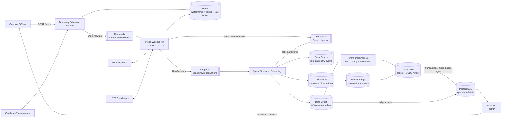

# Real-Time EASM Ingestion Platform

A production-shaped, IONIX-inspired External Attack Surface Management (EASM)
platform. It turns internet-facing signals into canonical assets, source-specific
security findings, and infrastructure blast-radius clusters.

The project demonstrates distributed ingestion, asynchronous network probing,
stream processing, graph-based entity resolution, temporal state, and an
operational serving layer on a local Kubernetes cluster.

For the complete supported-feature matrix, component algorithms, data model,
reliability model, and detailed flow diagrams, see the
[architecture and feature guide](docs/architecture.md).

## Architecture



## End-to-End Algorithm

1. **Onboard a domain**
   - `POST /scans` receives a tenant and root domain.
   - The scheduler normalizes the hostname and reads the last CT record ID from
     Redis.
   - It queries `crt.sh` (or deterministic offline fixtures), extracts in-scope
     FQDNs, and advances the watermark only after processing newer records.
   - Redis `SET ... NX` suppresses duplicate schedules for a tenant, FQDN, and
     one-hour time bucket.

2. **Publish work**
   - One `DiscoveryTask` is published per FQDN to
     `easm.discovery.tasks`.
   - The topic key is `tenant_id:fqdn`, so all observations for one asset remain
     ordered on the same partition.
   - Publish failures remove the Redis dedup reservation so the task can be
     retried safely.

3. **Probe the asset**
   - Probe workers consume as the `easm-probe-workers` consumer group.
   - A shared Redis Lua token bucket coordinates DNS quota across all pods.
   - DNS probing resolves A records and follows a bounded CNAME chain. A CNAME
     whose terminal host returns `NXDOMAIN` becomes a potential dangling-resource
     finding.
   - When the host has an address, TLS probing extracts the negotiated protocol,
     certificate SHA-256, expiry, and SANs. HTTP probing records status and
     technology headers.
   - Probes run concurrently behind `PROBE_CONCURRENCY`, but Kafka offsets are
     committed only after the complete fetched batch finishes, preventing an
     early task from acknowledging work that a later task has not completed.
   - Messages that cannot be processed are emitted to the DLQ and then included
     in the committed batch.

4. **Validate and land raw events**
   - Spark parses Kafka values against `ENVELOPE_SCHEMA`.
   - Required-field failures are routed to `easm.dlq.errors`.
   - Valid `RawEnvelope` records are appended to date-partitioned Delta Bronze.
     Bronze is the immutable audit and replay source.

5. **Normalize Silver**
   - FQDNs are lowercased, trimmed, and stripped of wildcard/trailing-dot
     notation.
   - A stable `asset_id` is derived from `(tenant_id, fqdn)`, deliberately
     independent of IP address and cloud load balancer identity.
   - Exposure rules translate dangling CNAMEs, expired certificates, and weak
     TLS protocols into source-specific findings and validation tiers.

6. **Resolve the infrastructure graph**
   - Silver observations emit:
     - `fqdn -> ip` as `RESOLVES_TO`
     - `fqdn -> terminal CNAME` as `CNAME_TO`
     - `fqdn -> certificate` as `PRESENTS_CERT`
     - `certificate -> SAN` as `COVERS_SAN`
   - New edges are merged into Delta before clustering so tenants are evaluated
     against their accumulated subgraph, not just the current five-second batch.
   - Shared-CDN edges and infrastructure hubs above the configurable degree
     threshold are excluded to avoid merging unrelated tenants or customers
     through Cloudflare, public anycast, or multi-tenant cloud IPs.
   - The resolver groups edges by tenant with `applyInPandas` and executes
     Union-Find with path compression. The lexicographically smallest node is
     the deterministic cluster ID.
   - Root cause selection prefers `CNAME_TO`, then `PRESENTS_CERT`, then
     `RESOLVES_TO`. This produces a useful remediation grouping instead of a
     vague IP-only cluster.
   - Updated cluster assignments are propagated to previously ingested assets in
     Delta and PostgreSQL when a newly observed edge bridges components.

7. **Resolve effective exposure state**
   - Findings are stored by `(asset_id, source, exposure_type)`.
   - A clean TLS observation therefore cannot erase an active DNS finding.
   - The highest-severity surviving finding determines the current asset state:
     `confirmed_exploitable` > `potentially_affected` > `informational`.
   - Exposure transitions use SCD Type 2 semantics in Delta Gold:
     `valid_from`, `valid_to`, and `is_current` preserve when state changed.

8. **Serve operational state**
   - Each Spark micro-batch truncates pre-created PostgreSQL `UNLOGGED` staging
     tables, avoiding repeated `DROP TABLE` operations and catalog locks.
   - The service transaction upserts assets, findings, edges, and cluster changes
     together. A failure rolls back the database sync.
   - The FastAPI layer serves current inventory and blast-radius clusters:
     - `GET /tenants/{tenant_id}/assets`
     - `GET /tenants/{tenant_id}/assets?status=exposed`
     - `GET /tenants/{tenant_id}/clusters`

## Component Responsibilities

| Component | Responsibility | Does not own |
| --- | --- | --- |
| Discovery Scheduler | CT polling, domain scope, watermarks, task deduplication | DNS/TLS probing or entity resolution |
| Redis | Cross-pod rate state, scheduler checkpoints, short-lived dedup keys | Analytical history or operational inventory |
| Redpanda topics | Durable handoff, backpressure, replay, partition ordering | Entity state or serving queries |
| Probe Workers | Bounded asynchronous DNS/TLS/HTTP collection and source evidence | Historical joins or UI-facing state |
| Spark Processor | Schema validation, medallion transforms, graph resolution, temporal state | Synchronous request handling |
| Delta Lake | Auditable Bronze, normalized Silver, graph, findings, Gold history | Low-latency API queries |
| PostgreSQL | Current operational asset and cluster snapshot | Raw-event archive or distributed stream coordination |
| Asset API | Indexed tenant inventory and blast-radius views | Scanning or network access |

## Architecture Decisions

### Event-driven services instead of one batch process

Discovery, probing, transformation, and serving have different scaling and
failure characteristics. Kafka-compatible topics isolate them and let workers
fan out independently without losing the raw event history. The tradeoff is
more operational machinery, which is intentional for demonstrating platform
engineering rather than scripting.

### FQDN as the canonical entity anchor

Cloud IPs rotate and load balancers are shared. A tenant-scoped normalized FQDN
provides a stable `asset_id`, while IP, CNAME, certificate, and SAN relationships
remain graph evidence. This preserves attribution without incorrectly treating
shared infrastructure as the asset itself.

### Graph clustering with explicit anti-collapse controls

Naive connected components would merge unrelated organizations through a CDN or
shared cloud IP. The platform records an explicit `is_shared_infra` flag and
prunes high-degree destination nodes before clustering. This is a deliberately
conservative resolver: it may leave an uncertain edge isolated rather than
creating a high-impact false blast radius.

### Union-Find per tenant

Iterative Spark self-joins require repeated shuffles and jobs. Once a tenant's
full subgraph is selected, an in-memory Union-Find implementation performs
connected-component resolution efficiently with path compression and
deterministic union order. This is suitable for the mini-product's bounded
tenant graphs; a very large production graph would move to a dedicated graph
engine or distributed graph partitioning.

### Delta Lake for analytical truth, PostgreSQL for serving

Delta provides append-only auditability, ACID table updates, replay-friendly
checkpoints, and SCD2 history. PostgreSQL provides indexed, low-latency current
state for APIs. The serving database is therefore a projection, not the source
of truth.

### Source-specific findings

Security evidence is multi-source and asynchronous. A single `exposure_type`
column on the asset causes last-writer-wins bugs. Keeping one current finding
record per asset/source/exposure makes clean events source-local and allows the
Gold asset to aggregate severity deterministically.

### Controlled probe concurrency and distributed quotas

Async I/O increases probe density, while a semaphore bounds work in each pod and
Redis Lua provides an atomic cluster-wide quota. Manual Kafka offset commits
happen only after a complete batch, favoring at-least-once correctness over
silently dropping events. Deterministic IDs and idempotent Delta merges make
replays safe.

### Offline fixtures and the same event contracts

`OFFLINE_MODE=true` exercises the full scheduler, Kafka, Spark, Delta, PostgreSQL,
and API path without depending on public CT/DNS/HTTP availability. Live mode
switches collectors, not the platform's contracts or processing algorithm.

## Security and Product Boundaries

This is a learning-oriented mini-production platform inspired by modern EASM
products such as IONIX. It is not affiliated with IONIX.

- It performs discovery and observation, not exploitation.
- It stores tenant IDs in identifiers and event payloads but does not yet include
  production identity, authorization, secrets management, or a tenant
  administration model.
- TLS certificate verification is intentionally disabled for observation so
  expired/self-signed certificates become findings. This must not be reused as
  a trusted HTTPS client configuration.
- Public-internet scanning requires authorized scope, provider rate limits, and
  an allow/deny policy before production use.

## Kafka Contract

| Topic | Producer | Consumer | Partition key | Purpose |
| --- | --- | --- | --- | --- |
| `easm.discovery.tasks` | Discovery Scheduler | Probe Workers | `tenant_id:fqdn` | Work distribution |
| `easm.raw.observations` | Probe Workers | Spark Processor | `tenant_id:fqdn` | Immutable observation stream |
| `easm.dlq.errors` | Workers / Spark | Monitoring and replay | Event key | Schema and unrecoverable failures |

## Local Kubernetes

Requires Docker, kind, and kubectl.

```bash
make up
kubectl get pods -n easm -w
```

Trigger a deterministic offline scan:

```bash
kubectl port-forward -n easm svc/discovery-scheduler 8000:8000
curl -X POST http://localhost:8000/scans \
  -H 'Content-Type: application/json' \
  -d '{"tenant_id":"tenant_beta","root_domain":"corp-example.io"}'
```

Read operational state:

```bash
kubectl port-forward -n easm svc/asset-api 8080:8080
curl "http://localhost:8080/tenants/tenant_beta/assets?status=exposed"
curl "http://localhost:8080/tenants/tenant_beta/clusters"
```

Inspect streaming data and stop the cluster:

```bash
kubectl exec -n easm deploy/redpanda -- \
  rpk topic describe easm.raw.observations
make down
```

Set `OFFLINE_MODE` to `"false"` in [k8s/02-apps.yaml](k8s/02-apps.yaml) and
redeploy to enable live public-internet probing.

## Development and CI

```bash
python -m venv .venv
source .venv/bin/activate
pip install -e ".[dev,spark]"
ruff check services tests
pytest -v tests/test_platform.py
```

Graph tests run in the production Spark/Java container so local Python or JDK
differences cannot hide analyzer and Arrow compatibility issues:

```bash
docker build -f Dockerfile.spark -t easm-spark:test .
docker run --rm --user root \
  -v "$PWD:/workspace" \
  -w /workspace \
  easm-spark:test \
  /bin/bash -lc \
  'export PYTHONPATH="/opt/spark/python:$(echo /opt/spark/python/lib/py4j-*-src.zip):/workspace/services"; \
   python3 -m pip install --no-cache-dir pytest pytest-asyncio >/dev/null; \
   python3 -m pytest -v tests/test_graph_resolution.py'
```

## Repository

```text
services/
  shared/                 Event contracts, configuration, Redis limiter
  discovery_scheduler/    CT discovery and task publishing
  probe_worker/           Kafka consumer and network probe engine
  spark_processor/        Bronze, Silver, Gold, DLQ, graph resolution
  asset_api/              Operational FastAPI service
tests/
  test_platform.py        Scheduler and probe behavior
  test_graph_resolution.py Spark graph behavior
k8s/                      Local kind infrastructure and deployments
```
