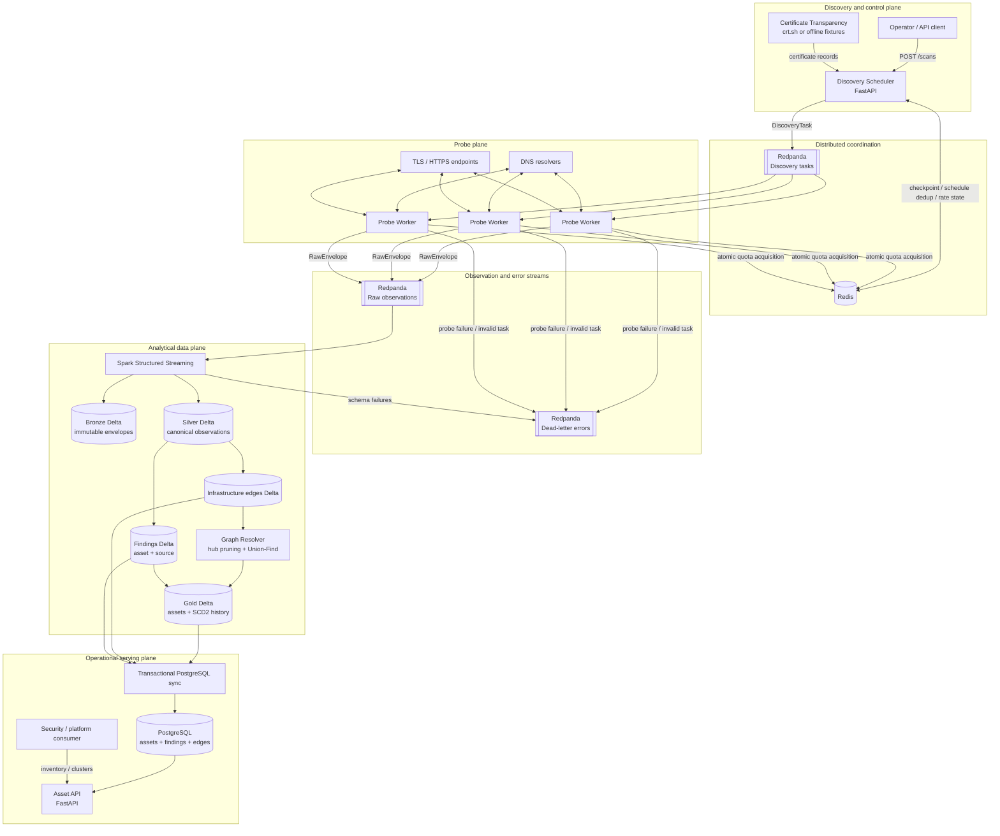
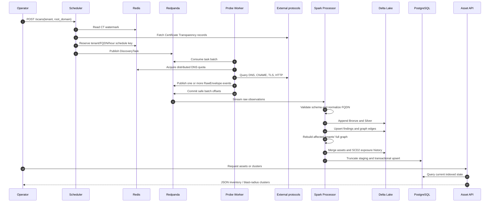
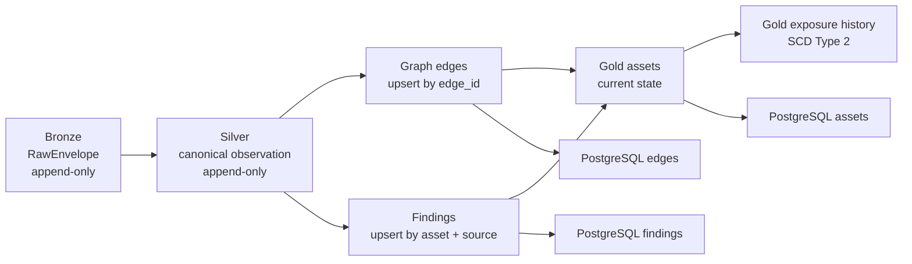
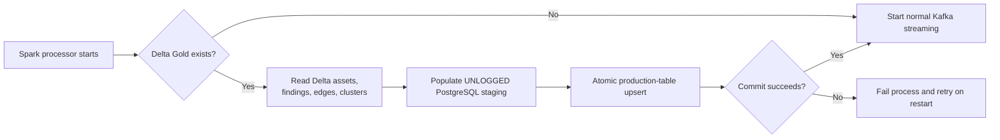

# EASM Platform Architecture and Supported Features

## 1. Product Scope

This repository is a mini-production External Attack Surface Management (EASM)
platform inspired by graph-based products such as IONIX. It is not affiliated
with IONIX and does not claim parity with a commercial EASM platform.

The implemented product loop is:

1. Receive or schedule a root domain.
2. Discover candidate FQDNs from Certificate Transparency.
3. Probe DNS, TLS, and HTTP asynchronously.
4. Publish immutable observations to an event stream.
5. Validate and normalize observations in Delta Lake.
6. Resolve assets and infrastructure relationships as a tenant-scoped graph.
7. Compute blast-radius clusters and root-cause infrastructure nodes.
8. Preserve source-specific findings and exposure state history.
9. Serve current inventory and cluster views through an API.

## 2. System Block Diagram



## 3. Data-Flow Sequence



## 4. Supported Feature Matrix

| Area | Supported feature | Implementation |
| --- | --- | --- |
| Domain onboarding | On-demand tenant/root-domain scans | `POST /scans` |
| Passive discovery | Certificate Transparency polling | `crt.sh` query |
| Deterministic mode | Offline CT, DNS, TLS, and HTTP fixtures | `OFFLINE_MODE=true` |
| Watermarks | Durable CT cursor per tenant/domain | Redis checkpoint key |
| Discovery deduplication | Hour-bucket schedule reservation | Redis `SET NX` with TTL |
| Message durability | Kafka-compatible event transport and replay | Redpanda topics |
| Partition ordering | Asset-local event ordering | `tenant_id:fqdn` partition key |
| Worker scaling | Horizontally replicated consumer-group workers | Kubernetes Deployment, three replicas |
| Concurrency control | Bounded in-pod asynchronous task processing | `asyncio.Semaphore` |
| Batch offsets | Commit only after the fetched batch completes | Manual consumer offsets |
| DNS collection | A-record resolution | dnspython async resolver |
| CNAME collection | Bounded chain traversal with cycle prevention | Maximum eight hops |
| Dangling-resource detection | Terminal CNAME target returns `NXDOMAIN` | DNS exposure signal |
| Distributed quotas | Cross-pod token bucket for external requests | Redis Lua script |
| TLS collection | SNI handshake, protocol, cert hash, expiry, SANs | `ssl` and `cryptography` |
| Certificate fingerprinting | Stable SHA-256 of DER certificate bytes | `cert_sha256` |
| HTTP collection | Status code and server/CDN headers | `httpx` |
| Weak-TLS finding | Detects TLS 1.0, TLS 1.1, and SSLv3 | `weak_tls` flag |
| Expired-certificate finding | Compares certificate date with UTC time | `is_expired` flag |
| CDN awareness | Tags shared CDN evidence | Headers, SAN count, fixtures |
| Schema validation | Strict raw event schema and required-field checks | Spark `StructType` |
| Dead-letter handling | Quarantines worker and schema failures | `easm.dlq.errors` |
| Raw audit trail | Date-partitioned immutable observations | Delta Bronze |
| Canonical assets | Tenant-scoped FQDN normalization and deterministic ID | Spark Silver |
| Multi-source findings | Findings retained independently per source | Delta and PostgreSQL findings |
| Effective exposure state | Highest-severity surviving finding wins | Deterministic severity rank |
| Graph edge extraction | `RESOLVES_TO`, `CNAME_TO`, `PRESENTS_CERT`, `COVERS_SAN` | Spark graph transform |
| Full-subgraph resolution | Recomputes affected tenants after edge upsert | Delta accumulated edges |
| Hub pruning | Removes shared infrastructure and high-degree destinations | Degree threshold |
| Connected components | Tenant-local graph clustering | Union-Find in `applyInPandas` |
| Deterministic cluster IDs | Lexicographically smallest graph node | Union by smaller root |
| Root-cause grouping | CNAME, certificate, then IP priority | Per-FQDN upstream rank |
| Cluster propagation | Updates older assets when a later edge bridges components | Delta and PostgreSQL cluster merge |
| Temporal state | SCD Type 2 exposure windows | Delta Gold history |
| Operational projection | Current state synchronized to indexed tables | PostgreSQL |
| Transactional sync | Assets, findings, edges, and clusters update atomically | JDBC transaction and rollback |
| Lock-aware staging | Pre-created `UNLOGGED` staging tables are truncated | PostgreSQL `TRUNCATE` write mode |
| Tenant API | Full or status-filtered asset inventory | `GET /tenants/{tenant}/assets` |
| Blast-radius API | Exposures grouped by root-cause and cluster | `GET /tenants/{tenant}/clusters` |
| Health endpoints | Scheduler and API liveness checks | `/healthz` |
| Container packaging | Separate services and Spark images | Dockerfiles |
| Kubernetes deployment | Namespace, stateful dependencies, workloads, PVC | `k8s/` manifests |
| Infrastructure persistence | Redpanda, Redis, and PostgreSQL survive pod replacement | Dedicated PVC mounts |
| Serving recovery | PostgreSQL projection rebuilds from Delta Gold on Spark startup | Delta-to-JDBC recovery |
| Local lifecycle | Build, load, deploy, status, and teardown | `Makefile` |
| CI | Ruff, service tests, and Dockerized Spark graph tests | GitHub Actions |

## 5. Component Algorithms

### 5.1 Scheduler

```text
normalize domain
read Redis CT watermark
if offline:
    generate deterministic records
else:
    acquire CT quota
    fetch crt.sh records
for each record newer than watermark:
    extract in-scope FQDNs
for each discovered FQDN:
    atomically reserve tenant/FQDN/hour key
    publish DiscoveryTask
advance CT watermark
```

Important behavior:

- Newer CT records are processed incrementally.
- Hostnames outside the requested domain are excluded.
- A failed Kafka publish removes the Redis reservation.
- Duplicate schedules within the current hour are suppressed.

### 5.2 Distributed Rate Limiter

The Redis token bucket is implemented as one Lua script:

```text
read tokens and last-update time atomically
refill = elapsed_seconds * configured_rate
tokens = min(capacity, tokens + refill)
if tokens >= 1:
    consume one token
    return immediately
else:
    calculate wait time
    sleep and retry
```

The Lua operation is atomic, so three worker pods cannot independently spend the
same quota token. The rate state has a short expiry and is coordination state,
not analytical history.

### 5.3 Worker Consumption

```text
fetch bounded Kafka message batch
launch all messages behind a shared semaphore
for each message:
    parse DiscoveryTask
    run DNS probe
    publish DNS RawEnvelope
    if address records exist:
        run TLS/HTTP probe
        publish TLS RawEnvelope
    on unrecoverable failure:
        publish DLQ event
wait for the fetched batch
commit the maximum processed offset per partition
```

The delivery guarantee is at-least-once at the worker boundary. Deterministic
event IDs and idempotent downstream merges make replay safe.

### 5.4 Silver Normalization and Findings

```text
RawEnvelope
  -> normalize tenant-scoped FQDN
  -> calculate deterministic asset_id
  -> evaluate source-specific exposure rules
  -> write canonical Silver observation
  -> merge finding state by (asset_id, source)
  -> select highest-severity surviving finding
  -> derive effective asset status
```

Supported exposure rules:

| Rule | Source | Tier |
| --- | --- | --- |
| Dangling CNAME target | DNS | `confirmed_exploitable` |
| Expired certificate | TLS | `confirmed_exploitable` |
| Deprecated TLS protocol | TLS | `potentially_affected` |
| No active rule | DNS or TLS | `informational` / clean |

### 5.5 Graph Resolution

Graph nodes use typed prefixes:

```text
fqdn:app.example.com
ip:203.0.113.10
cert:<sha256>
```

The graph emits these directed edge types:

```text
fqdn  --RESOLVES_TO-->  ip
fqdn  --CNAME_TO-->     fqdn
fqdn  --PRESENTS_CERT-> cert
cert  --COVERS_SAN-->   fqdn
```

Before connected-component resolution:

1. Drop edges marked as shared infrastructure.
2. Count distinct source FQDNs per destination node and tenant.
3. Drop destinations whose degree exceeds the hub threshold.
4. Group remaining edges by tenant.

Within one tenant partition:

```text
for each clean edge:
    union(source, destination)
    remember best upstream root cause for each FQDN
for each FQDN:
    cluster_id = representative root
    root_cause = ranked direct upstream node
```

The representative is selected deterministically using lexicographic union, and
path compression keeps repeated `find` operations efficient.

## 6. Storage Model



### Delta Lake

- **Bronze:** immutable source payload, partitioned by ingestion date.
- **Silver:** normalized, schema-enforced observation with stable asset identity.
- **Graph edges:** idempotent records keyed by deterministic `edge_id`.
- **Findings:** source-local active findings so clean events are not destructive.
- **Gold assets:** latest asset, cluster, technology, and exposure state.
- **Exposure history:** one active interval per effective state transition.

### PostgreSQL

- `gold_assets`: current operational inventory.
- `gold_asset_findings`: source-specific active findings.
- `gold_asset_edges`: graph relationships.
- `gold_assets_staging` and related tables: transient `UNLOGGED` JDBC staging.

Spark truncates staging tables and performs production upserts in an explicit
transaction. This avoids dropping and recreating catalog objects every
micro-batch.

## 7. Reliability and Consistency

### Delivery semantics

- Scheduler-to-worker and worker-to-stream transport is at-least-once.
- Kafka events may be replayed after a restart.
- Stable event IDs, deterministic graph keys, Delta merges, and PostgreSQL
  conflict handling make replay idempotent for the modeled state.

### State consistency

- Delta Lake is the analytical source of truth.
- PostgreSQL is an operational projection.
- Spark checkpoints preserve stream progress.
- PostgreSQL synchronization is a single database transaction.
- A PostgreSQL failure rolls back that serving update and leaves Spark's source
  data available for retry/recovery.

### Failure isolation

| Failure | Current behavior |
| --- | --- |
| CT request fails | Offline fixture fallback with delayed retry behavior |
| Kafka publish fails | Scheduler removes Redis dedup reservation and raises |
| Probe task fails | Error event is published to DLQ |
| Raw schema fails | Spark publishes schema error to DLQ |
| One slow probe task | Local concurrency is bounded; batch commit waits for completion |
| PostgreSQL sync fails | JDBC transaction rolls back |
| Shared infrastructure inflates graph | Shared flag and hub-degree pruning reduce false merges |

## 8. API Surface

### Discovery

```http
POST /scans
Content-Type: application/json

{
  "tenant_id": "tenant_beta",
  "root_domain": "corp-example.io"
}
```

### Health

```http
GET /healthz
```

### Assets

```http
GET /tenants/{tenant_id}/assets
GET /tenants/{tenant_id}/assets?status=clean
GET /tenants/{tenant_id}/assets?status=exposed
```

### Blast-radius clusters

```http
GET /tenants/{tenant_id}/clusters
```

Cluster responses include:

- root-cause infrastructure node
- deterministic cluster ID
- exposure type
- validation tier
- affected asset count
- ordered affected FQDN list

## 9. Deployment Design

The local Kubernetes deployment includes:

| Workload | Replicas | Purpose |
| --- | ---: | --- |
| `redpanda` | 1 | Kafka-compatible transport |
| `redis` | 1 | Coordination and distributed rate state |
| `postgres` | 1 | Operational serving state |
| `discovery-scheduler` | 1 | Discovery and API ingress |
| `probe-worker` | 3 | Horizontally scalable probe consumers |
| `asset-api` | 1 | Inventory and cluster API |
| `spark-stream-processor` | 1 | Stateful streaming driver |

The Spark processor mounts a `PersistentVolumeClaim` for Delta tables and
stream checkpoints. The production Spark image preloads Kafka, Delta, and
PostgreSQL connector jars into the runtime user's Ivy cache.

Redpanda, Redis, and PostgreSQL also have dedicated persistent volume claims.
Redis uses append-only persistence plus scheduled snapshots so scheduler
watermarks and hourly deduplication keys survive pod replacement. PostgreSQL
contains an operational projection of Delta; if that projection is empty after
recovery, Spark rebuilds it from Delta before starting new stream ingestion.

## 9.1 PostgreSQL Recovery Sequence



## 10. Current Non-Goals

The following are intentionally not implemented in this mini-production product:

- user authentication, authorization, and tenant isolation policies
- secret manager integration and workload identity
- exploit execution or active vulnerability validation
- browser-rendering or JavaScript application discovery
- redirect/script/iframe dependency graphs
- operational PostgreSQL exposure-history endpoint
- Prometheus/Grafana dashboards and alerting
- KEDA consumer-lag autoscaling
- multi-node Spark or cloud object storage
- production TLS verification for API-to-provider calls
- complete external-provider retry, circuit-breaker, and quota accounting
- legal scanning authorization and provider-specific terms controls

These limits are important: the repository demonstrates the architecture and
algorithms of a graph-based EASM product, not the full security, compliance,
and scale envelope of a commercial service.

## 11. Verification

CI separates the runtime environments deliberately:

1. Python 3.12 job:
   - installs service dependencies
   - runs Ruff
   - runs scheduler/worker tests
2. Spark container job:
   - builds `Dockerfile.spark`
   - uses Spark 4.0.1 and Java 17
   - runs graph tests against the same Spark/Arrow/JVM family used by deployment

This avoids validating graph code against a materially different local runtime.
